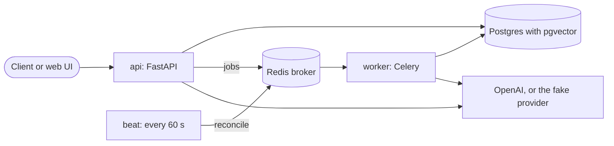

# Doc Vault

Doc Vault is a document vault you can talk to. Upload a document and it writes a summary, tags and key facts. Then ask questions about one document or several, in plain language. Every answer, every compared value and every summary source points at a page you can open and check.

It answers the "AI-Powered Vault Document System" case study. The backend is a FastAPI app with Celery workers, Postgres with pgvector, Redis and the OpenAI API. A small web UI sits on top.

## What it covers

Everything the case study requires:

| Requirement | How it is met |
|---|---|
| Upload and asynchronous processing | `POST /documents` returns 202 at once. Celery workers parse, chunk and embed the file, then write its insights. |
| Document retrieval | `GET /documents` lists documents, with paging and a status filter. `GET /documents/{id}` returns one, with its status. |
| AI insights | `GET /documents/{id}/insights` returns a title, a type, a summary, tags and key facts. Each key fact has its page and a quote found on that page. |
| Document chat | `POST /chats` starts a chat, `POST /chats/{id}/messages` asks a question, and `GET /chats/{id}/messages` returns the history. A follow-up is rewritten into a standalone question, and every answer cites its pages. |
| Metrics | `GET /metrics/documents` returns document statistics. `GET /metrics/processing` returns processing metrics, tokens and cost. |
| Data storage | One Postgres schema, `docvault/schema.sql`, holds documents, insights, chats, turns with their citations, processing steps and AI calls. |

From the case study's bonus list:

- **Advanced AI features.** Multi-document chat, follow-up suggestions, summary options (length, focus and tone), a document type and tags, key facts, and side-by-side comparison.
- **Technical excellence.** A web UI, live status updates, streamed answers, caching in Redis, pgvector, and tests for the backend and the UI.
- **Production readiness.** Cost tracking with a daily spending cap, rate limits, document versions, batched embedding, request ids in the logs, and a health check.

## Run it

You need Docker.

```bash
cp .env.example .env      # then set OPENAI_API_KEY in .env
docker compose up --build -d
curl localhost:8000/health
```

`GET /health` returns `"ai_mode": "live"` when `OPENAI_API_KEY` is set. With no key the stack still runs, on a deterministic fake provider, and `/health` returns `"ai_mode": "fake"`. The fake provider is for tests and offline runs, so judge answer quality with a key.

- The web UI is at `http://localhost:3000`.
- Swagger is at `http://localhost:8000/docs`.

`API_PORT`, `DB_PORT` and `WEB_PORT` change the host ports, so a second stack can run beside the first:

```bash
API_PORT=18000 DB_PORT=54339 WEB_PORT=13000 docker compose -p docvault-demo up --build -d
```

`.env.example` lists the common settings, and `docvault/config.py` lists every setting. To cap AI spend, set `DAILY_AI_BUDGET_USD`, in US dollars per day.

## Try it

**In the web UI.** Upload documents, read their insights, chat with citations that open the cited page, compare two documents, and see the metrics. `web/README.md` describes the UI.

**From the command line.** `scripts/demo.sh` drives the API with `curl` and `jq`. It uploads the three samples, waits until they are ready and their insights exist, prints the insights, then chats with them and prints every answer with its citations. It ends with the metrics.

```bash
scripts/demo.sh                              # API on localhost:8000
API=http://localhost:18000 scripts/demo.sh   # another stack
```

A rerun on the same stack finds the samples already uploaded (HTTP 200) and reuses them.

`samples/` holds three fictitious documents for the same insured: a seven-page commercial general liability policy (PDF), a three-page renewal quote with changed figures (PDF), and a short endorsement (DOCX). `samples/facts.yaml` lists the facts planted in them, each with its document, page and exact text. The tests and evals read that file as their expected values. To regenerate the samples, run `uv run python scripts/make_samples.py`.

## How it works



A second Redis holds the embedding cache and the answer cache, and the app runs without it. Uploaded files live on disk.

**From upload to ready**

1. `POST /documents` saves the file, returns 202 and queues it. The same bytes uploaded again return the existing document.
2. A Celery worker parses the file into pages, cuts the pages into overlapping chunks, and embeds the chunks in batches. The document is then `ready`.
3. A second task writes the insights. A key fact is kept only when its quote is on the page it cites.
4. A step that fails is retried. If a worker dies, `reconcile` finds the document after two minutes without progress and queues it again. No finished work is paid for twice.

**From question to answer**

1. A follow-up is rewritten into a standalone question, from the last four turns.
2. The question is embedded. One SQL statement then ranks the chunks of the chat's documents by vector distance and full-text rank.
3. If no chunk passes the relevance gate, the chat answers "not found" and makes no answer call.
4. Otherwise the model answers from eight sources and quotes each source it uses.
5. The code looks for every quote in the source it names. It drops a quote it cannot find, and a kept citation names the page where its quote starts.

**Scale.** Uploads return at once and the work runs in Celery workers, so more `worker` replicas raise ingest throughput, and a lock on each document keeps duplicate jobs harmless. A file uploaded twice is stored and indexed once. Retrieval cost depends on the documents in a chat, not on the size of the vault. `docs/design.md` has timings at 5,000 and 50,000 documents, and says what changes past that.

**Prompts.** `docvault/prompts.py` holds every prompt. Each prompt is versioned and carries a note on why it is worded the way it is. `docs/design.md` gives that reasoning in short.

## Answer quality

`docs/evals.md` scores a fixed set of 44 questions on the sample documents. 28 of them can be answered, with 34 expected facts between them, and 16 cannot.

| Measure | With the OpenAI models | On the fake provider |
|---|---|---|
| Retrieval finds the expected fact | 34 of 34 | 21 of 34 |
| The answer cites the fact on the right page | 30 of 34 | 7 of 34 |
| A question with no answer in the documents is refused | 15 of 16 | 15 of 16 |

One live run also covered 19 public insurance documents. Of 25 answerable questions, 21 were answered right and 4 in part, and every citation was on the page it named. `AI_USAGE.md` has the details.

## API

| Route | What it does |
|---|---|
| `POST /documents` | Upload a file. |
| `GET /documents`, `GET /documents/{id}` | List documents, or read one. |
| `GET /documents/{id}/insights` | Read the summary, tags and key facts. |
| `GET /documents/{id}/pages/{n}` | Read the page that a citation points at. |
| `GET /documents/{id}/versions` | List every version of a document. |
| `POST /documents/{id}/retry`, `DELETE /documents/{id}` | Rerun a failed step, or delete a document. |
| `POST /chats`, `GET /chats`, `GET /chats/{id}` | Start a chat over one or more documents, list chats, or read one. |
| `POST /chats/{id}/messages` | Ask a question. |
| `POST /chats/{id}/messages/stream` | Ask a question and stream the answer. |
| `GET /chats/{id}/messages` | Read the chat history. |
| `POST /comparisons`, `GET /comparisons`, `GET /comparisons/{id}` | Compare 2 to 5 documents field by field, list comparisons, or read one. |
| `POST /documents/{id}/summaries`, `GET /documents/{id}/summaries` | Write the summary again at a length, focus and tone, or list the stored ones. |
| `GET /events/documents` | Stream live document status. |
| `GET /metrics/documents`, `GET /metrics/processing` | Read the document statistics and the processing metrics. |
| `GET /health` | Check Postgres, Redis, the AI mode, the spending cap and the cache. |

Every error has one shape, `{"error": {"code", "message", "retryable", "details"}}`. `docs/api.md` is the full reference, with a `curl` example for every route.

## Assumptions and design choices

The app assumes:

- The users are insurance brokers and their clients, and the documents are policies, quotes and endorsements in English.
- Files are PDF, DOCX or TXT, at most 50 MB and 2,000 pages. A scanned PDF fails with `no_extractable_text`, because OCR is out of scope. A PDF that needs a password to open fails with `encrypted_pdf`.
- DOCX and TXT have no reliable page numbers, so their citations name a section, not a page.
- There is one vault and no login. Rate limits apply per client address.
- A chat's documents are fixed when the chat starts. If one of them is deleted, the chat refuses new questions with 409 `documents_deleted`.

The app uses neither LangChain nor LlamaIndex. Every citation must point at the page its words are on, and two steps in the code make that hold:

- `pages.chunk` cuts the text into chunks and records the page of every character, so a chunk that crosses a page break still knows where each word came from.
- `chat.ground` keeps a quoted passage only when `pages.locate_quote` finds it in the source the model named, and cites the page where that passage starts.

Retrieval is one SQL statement, `chat.EXACT_SQL`, that ranks the chat's chunks by pgvector distance and Postgres full-text rank. A framework would put its own chunking and retrieval in place of these steps. Kept in the repo, each step is tested and can be explained line by line. `docs/design.md` covers the other choices.

## Test it

The tests use the compose Postgres on host port 54329, in their own database (`vault_test`). They call no model provider.

```bash
docker compose up -d db
uv run pytest
uv run ruff check
```

`TEST_DATABASE_URL` points the tests at another database. The eval test also creates `<that name>_evals`.

## Known limits

- Without `OPENAI_API_KEY`, answers come from the fake provider, which often quotes a neighbouring passage.
- The tests use canned HTTP responses for the OpenAI backends. One live run on 2026-11-12 covered the eval set and 19 public insurance documents.
- Insights read the first 240,000 characters of a document, so a longer document is covered only in part.
- A chat sends eight passages to the answer step. On a 246-page manual, the passage that answered one question was not among them.
- "Differs" in a comparison compares the text of two values, not their meaning, so two wordings of the same term are marked as different.
- A comparison and a summary each run inside the request, as one model call of at most 90 s.
- The spending cap is checked before each call, not reserved, so the day's spend can pass the cap.
- Rate limits are per API process and per client address.
- A new version is linked by filename alone, so two unrelated files uploaded under one name become versions of one document.

`docs/design.md` ends with the full list.

## More to read

- `AI_USAGE.md` explains how AI coding tools were used, where the AI was wrong, and what caught it.
- `docs/design.md` covers the data model, the request flows, retrieval, the prompts, the caches, scale and every known limit.
- `docs/api.md` is the API reference.
- `docs/evals.md` has the answer-quality results and how they are measured.
- `docs/lifecycle.md` shows how a document moves through indexing, as a state chart checked with the TLA+ model in `formal/`.
- `.claude/skills/` holds the two verification kits that the AI agents ran: one drives the running app end to end, and one rechecks the lifecycle model.
