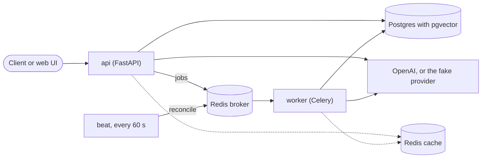

# Doc Vault

Doc Vault is a document vault you can talk to. Upload a document and it writes a summary, tags and key facts. Then ask questions about one document or several, in plain language. Answers, compared values and summaries quote their documents. The code keeps a quote only when it finds those words on the page it cites, so you can open that page and check. It answers the "AI-Powered Vault Document System" case study, covers everything it requires, and adds items from its bonus list. The backend is a FastAPI app with Celery workers, Postgres with pgvector, Redis and the OpenAI API. A small web UI sits on top. It was built with Claude Code, an AI coding agent. [`AI_USAGE.md`](AI_USAGE.md) says how the agents were used, where they were wrong, and what caught each mistake.

## What it covers

| Requirement | How it is met |
|---|---|
| Upload and asynchronous processing | `POST /documents` returns 202 at once. Celery workers parse, chunk and embed the file, then write its insights. |
| Document retrieval | `GET /documents` lists documents, with paging and a status filter. `GET /documents/{id}` returns one, with its status. |
| AI insights | `GET /documents/{id}/insights` returns a title, a type, a summary, tags and key facts. Each key fact has its page and a quote found on that page. |
| Document chat | `POST /chats` starts a chat, `POST /chats/{id}/messages` asks a question, and `GET /chats/{id}/messages` returns the history. A follow-up is rewritten into a standalone question, and every answer cites its pages. |
| Metrics | `GET /metrics/documents` returns document statistics. `GET /metrics/processing` returns processing metrics, tokens and cost. |
| Data storage | One Postgres schema, [`docvault/schema.sql`](docvault/schema.sql), holds documents, insights, chats, turns with their citations and retrieval logs, processing steps and AI calls. |

From the bonus list ([how each works](docs/bonus-features.md)):

- **Advanced AI features.** Multi-document chat, follow-up suggestions, summary options (length, focus and tone), a document type and tags, key facts, and side-by-side comparison.
- **Technical excellence.** A web UI, live status updates, streamed answers, caching in Redis, pgvector, and tests for the backend and the UI.
- **Production readiness.** Cost tracking with a daily spending cap, rate limits, document versions, batched embedding, request ids in the logs, and a health check.

## Run it

You need Docker.

```bash
cp .env.example .env      # set OPENAI_API_KEY in .env for real answers
docker compose up --build -d
curl --retry 10 --retry-all-errors --retry-delay 1 localhost:8000/health   # retries while the API starts
```

- The web UI is at `http://localhost:3000`.
- Swagger is at `http://localhost:8000/docs`.

`GET /health` returns `"ai_mode": "live"` when `OPENAI_API_KEY` is set. With no key the stack still runs, on a deterministic fake provider, and `/health` returns `"ai_mode": "fake"`. The fake provider is for tests and offline runs, so judge answer quality with a key.

`live` means that a key is set, not that the key works. To confirm it, ask one question and read `GET /metrics/processing`. On the default models, its `ai.cost_usd` is then above zero.

If your key cannot use a default model, set another one in `.env`. [`.env.example`](.env.example) lists the common settings, with the default models, and [`docvault/config.py`](docvault/config.py) lists every setting. For a model that takes no reasoning effort, such as `gpt-4.1` or `gpt-4o`, also leave `OPENAI_CHAT_REASONING_EFFORT` and `OPENAI_SMALL_REASONING_EFFORT` empty. Cost tracking knows the prices of the default models and a few others (`PRICES` in [`docvault/ai.py`](docvault/ai.py)), so calls to another model are logged without a cost. To cap AI spend, set `DAILY_AI_BUDGET_USD`, in US dollars per day.

`API_PORT`, `DB_PORT` and `WEB_PORT` change the host ports, so a second stack can run beside the first:

```bash
API_PORT=18000 DB_PORT=54339 WEB_PORT=13000 docker compose -p docvault-demo up --build -d
```

## Try it

**In the web UI.** Upload documents, read their insights, chat with citations that open the cited page, compare documents side by side, and see the metrics. [`web/README.md`](web/README.md) describes the UI.

**From the command line.** [`scripts/demo.sh`](scripts/demo.sh) drives the API with `curl` and `jq`. It uploads the three samples, waits until they are ready and their insights exist, prints the insights, then chats with them and prints every answer with its citations. It ends with the metrics. A rerun on the same stack finds the samples already uploaded (HTTP 200) and reuses them.

```bash
scripts/demo.sh                              # API on localhost:8000
API=http://localhost:18000 scripts/demo.sh   # another stack
```

`samples/` holds three fictitious documents for the same insured, and [`samples/facts.yaml`](samples/facts.yaml) lists the facts planted in them ([the case set](docs/evals.md#the-case-set)).

## How it works



The cache Redis holds the embedding cache and the answer cache, and the app runs without it. Uploaded files live on disk. Chunking, retrieval and the citation check are written in the repo, not taken from LangChain or LlamaIndex, because every citation must point at the page its words are on. Each step is tested and can be explained line by line ([why no RAG framework](docs/design.md#why-no-rag-framework)).

**From upload to ready**

1. `POST /documents` saves the file, returns 202 and queues it. The same bytes uploaded again return the existing document.
2. A Celery worker parses the file into pages, cuts the pages into overlapping chunks, and embeds the chunks in batches. The document is then `ready`.
3. A second task writes the insights. A key fact is kept only when its quote is on the page it cites.
4. A step that fails is retried. If a worker dies, `reconcile` finds the document after two minutes without progress and queues it again. No finished work is paid for twice.

**From question to answer**

1. A follow-up is rewritten into a standalone question, from the last four turns.
2. One SQL statement ranks the chunks of the chat's documents by vector distance and by full-text rank, and fuses the two ranks.
3. A question that names a page or a section ("page 45", "Exhibit 23") also gets the passages there.
4. If nothing passes the relevance gate and the question names no page or section, then with a key the answer step sees only each document's opening passage. That answers "What is this about?" from the title page. Anything else comes back "not found".
5. Otherwise the model answers from 16 sources and quotes each source it uses.
6. The code drops a quote it cannot find in the source it names, and a kept citation names the page where its quote starts. When it finds none, the turn is `unverified` and the draft answer is not shown.
7. The turn stores a retrieval log of the passages found and sent, which `GET /chats/{id}/messages/{turn_id}/retrieval` returns.

[`docs/design.md`](docs/design.md#request-flows) has each step in full. [`docvault/prompts.py`](docvault/prompts.py) holds every prompt, versioned, with a note on why it is worded the way it is. The answer prompt treats source text as data, asks for a verbatim quote for each marker, and prefers a decline to a guess. [`docs/design.md`](docs/design.md#prompts) gives the reason for each rule and [how the answer prompt changed](docs/design.md#how-the-answer-prompt-changed).

## Answer quality

[`docs/evals.md`](docs/evals.md) scores a fixed set of 44 questions on the sample documents. 28 of them can be answered and 16 cannot. On the OpenAI models, in the latest run, on 2026-11-18 at `703cca0`:

| What is counted | Out of | Result |
|---|---|---|
| Expected facts that retrieval sent to the answer step | The 34 facts that the 28 answerable questions expect. A question about two documents expects one fact in each. | 34 of 34 |
| Expected facts that the answer cites on the right page | The same 34 facts. | 27 of 34 |
| Questions with no answer in the documents that are declined | The 16 questions that cannot be answered. | 14 of 16 |
| Planted facts that appear in a key fact's quote, on its page | The 28 planted facts in `samples/facts.yaml`, not counting the two running footers, because a footer repeated on every page is not a key fact. | 20 of 28 |

Scoring is strict. A citation counts only on the page where the fact was planted ([what each number means](docs/evals.md#what-each-number-means)). Six of the seven citation misses also missed in the run before, where each answer cited the line of the renewal quote's change list on page 3 that states both values. Both out-of-scope questions counted as answered got answers saying the documents do not establish it ([results](docs/evals.md#results)).

The samples are small. They make 11 chunks, and each answer receives up to 16 passages, so at these settings retrieval cannot miss and 34 of 34 measures little. A retrieval-only benchmark asks 53 frozen questions about four public-domain PDFs of 2,633 pages. At `703cca0`, 52 of the 53 found a passage on the expected page within the 16 passages sent ([benchmark](docs/evals.md#retrieval-benchmark-on-long-public-documents)).

On 2026-11-17, on an earlier answer prompt (`answer-v2`), 50 questions were asked 91 times about 23 real insurance documents, which are kept outside this repository. Of the 80 asks with an answer in the documents, a script passed 71 with the expected value cited on an expected page, and a review of each miss passed 2 more. The other 7 were declined, and no answer gave a wrong figure ([real documents](docs/design.md#real-documents)).

## Performance

- Answers. In the latest eval run above, on the three samples, a chat turn took 7,542 ms at the 95th percentile. Sending 16 passages instead of eight fixed 7 of the real-document questions and raised the answer step's median time from 3.8 to 4.5 s. On 2026-11-12, with eight passages, the first piece of a streamed answer arrived after 2.7 s.
- Ingest. Uploads return at once and the work runs in Celery workers, so more `worker` replicas raise throughput. On 2026-11-17, 23 real documents, 3,263 pages, indexed with no failures, and the 922-page one was ready to chat 29.2 s after upload.
- Retrieval. Its cost depends on the documents in a chat, not on the size of the vault. Over all 5,539 chunks of those 23 documents it took 87 ms at the median.
- Metrics. With 50,000 synthetic documents and seven days of step and model-call rows, the metrics reads took 15 to 218 ms.

[`docs/design.md`](docs/design.md#scale) has the timings and says what changes past them.

## API

| Route | What it does |
|---|---|
| `POST /documents` | Upload a file. |
| `GET /documents`, `GET /documents/{id}` | List documents, or read one. |
| `GET /documents/{id}/insights` | Read the summary, tags and key facts. |
| `GET /documents/{id}/pages/{n}` | Read the page that a citation points at. |
| `GET /documents/{id}/versions` | List every version of a document. |
| `POST /documents/{id}/retry`, `DELETE /documents/{id}` | Rerun a failed step, or delete a document. |
| `POST /chats`, `GET /chats`, `GET /chats/{id}` | Start a chat over one or more documents, list chats, or read one. |
| `POST /chats/{id}/messages`, `POST /chats/{id}/messages/stream` | Ask a question, or ask and stream the answer. |
| `GET /chats/{id}/messages` | Read the chat history. |
| `GET /chats/{id}/messages/{turn_id}/retrieval` | Read what one turn's search found and what its answer step was sent. |
| `POST /comparisons`, `GET /comparisons`, `GET /comparisons/{id}` | Compare 2 to 5 documents field by field, list comparisons, or read one. |
| `POST /documents/{id}/summaries`, `GET /documents/{id}/summaries` | Write the summary again at a length, focus and tone, or list the stored ones. |
| `GET /events/documents` | Stream live document status. |
| `GET /metrics/documents`, `GET /metrics/processing` | Read the document statistics and the processing metrics. |
| `GET /health` | Check Postgres, Redis, the AI mode, the spending cap and the cache. |

Every error a route returns has one shape, `{"error": {"code", "message", "retryable", "details"}}`, except the 503 from `GET /health`, which carries the health report. [`docs/api.md`](docs/api.md) is the full reference, with a `curl` example for every route.

## Assumptions and design choices

[How it works](#how-it-works) explains why the app uses neither LangChain nor LlamaIndex, and [`docs/design.md`](docs/design.md) covers the other design choices.

The app assumes:

- The users are insurance brokers and their clients, and the documents are policies, quotes and endorsements in English.
- Files are PDF, DOCX or TXT, at most 50 MiB. A PDF may have up to 2,000 pages, and a Word or text file about 6,000,000 characters. A scanned PDF fails with `no_extractable_text`, because OCR is out of scope. [`docs/api.md`](docs/api.md#documents) lists the other parse failures.
- DOCX and TXT have no reliable page numbers, so their citations name a section, not a page.
- There is one vault and no login. Rate limits apply per client address.
- A file uploaded under the name of a stored document is its next version, so a broker who uploads a renewed policy needs no extra step. `?replaces=<id>` links a file with a different name.
- A chat's documents are fixed when the chat starts. If one of them is deleted, the chat refuses new questions with 409 `documents_deleted`.

## What was built first, and what was left out

The required backend was built first, in this order: upload and crash-safe indexing, insights, chat with citations, then the metrics, the evals and the demo script. The web UI was built beside it on its own branch. The other bonus features came after the backend passed its tests and evals, one at a time.

Besides OCR and logins, which the assumptions above cover, these were left out on purpose:

- A reranker, which could gain at most 1 of the 53 benchmark questions ([evals](docs/evals.md#what-the-benchmark-decided)).
- An approximate vector index. Retrieval scans only the chat's documents, exactly ([scale](docs/design.md#what-changes-past-that)).
- A table of contents in the answer prompt, which turned one question on a 922-page handbook into an unverified refusal ([prompts](docs/design.md#prompts)).
- Leaving repeated page headers and footers out of the chunks, which cost 2 of the 53 benchmark questions, and putting each chunk's section path in its embedded text, which gained none ([evals](docs/evals.md#what-the-benchmark-decided)).

The main known limits are that insights read the first 240,000 characters of a document, that a chat sends 16 passages to the answer step, and that "Differs" in a comparison compares the text of two values, not their meaning. [`docs/limits.md`](docs/limits.md) has the full list.

## Test it

You need [uv](https://docs.astral.sh/uv/) for the backend and Node 22.18 or later for the web UI. The backend tests use the compose Postgres on host port 54329, in their own database (`vault_test`). No test calls a model provider.

```bash
docker compose up -d db
uv run pytest
uv run ruff check
(cd web && npm ci && npm test && npm run lint && npm run typecheck)
```

On 2026-11-18 the backend tests covered 97% of the lines in `docvault/`. `uv run --with pytest-cov pytest --cov=docvault` measures it again.

To run the tests against a stack on another `DB_PORT`, see [Run the evals](docs/evals.md#run-the-evals).

## More to read

- [`docs/`](docs/) holds the design, the API reference, the evals, the bonus features and every known limit.
- Beyond the assignment: [`docs/lifecycle.md`](docs/lifecycle.md) is a state chart of indexing, checked with the TLA+ model in [`formal/`](formal/), and [`.claude/skills/`](.claude/skills/) holds the two verification kits that the AI agents ran.
