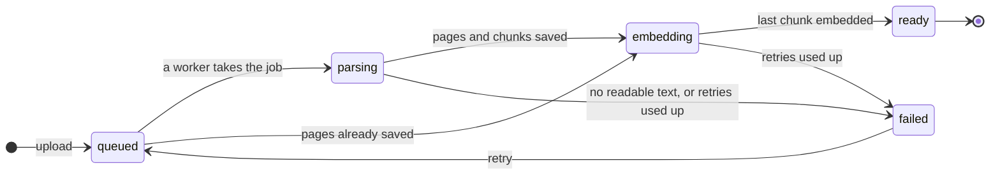

# Design

This page explains how Doc Vault stores documents, processes them, and answers questions about them. Every number and name on it comes from the code at the commit that changed it last. `docs/bonus-features.md` covers the features from the case study's bonus list, `docs/limits.md` lists every known limit, `docs/lifecycle.md` covers the indexing state machine and its TLA+ model, and `docs/evals.md` covers answer quality.

## Data model

Postgres 16 with pgvector holds every table. `docvault/schema.sql` is the only schema file, and `db.migrate()` applies it at process start when its hash is new. Each table has one module that writes it. `metrics.py` reads every table and writes none.

| Table | Written by | Holds |
|---|---|---|
| `documents` | `documents.py` | One row per distinct file (unique `sha256`): filename, kind, size, `status`, the parse facts (`page_basis`, `page_count`, `chunk_count`, `empty_pages`), the error of a failed document, and `requeued_at`, which only `reconcile` reads. `family_id` and `version` place it among the versions of one document, unique together. A first version's `family_id` is its own id. |
| `pages` | `documents.py` | The text of each page, or of each roughly 3,000-character section of a DOCX or TXT file. Citations and insights point here. |
| `chunks` | `documents.py` | Slices of about 1,800 characters with 250 characters of overlap. Each has a `page_map` of offsets to pages, an embedding tagged with `embedding_model`, and a generated `tsvector`. |
| `step_runs` | `db.pipeline_steps` | Append-only. One row per attempt of `parse`, `embed` or `analyze`, with its outcome and error code. |
| `document_insights` | `insights.py` | One row per document once insights exist or fail. No row means pending. |
| `chats`, `chat_documents` | `chat.py` | A chat and its fixed document scope, with a filename snapshot. |
| `chat_turns` | `chat.py` | One row per question: the standalone query, the outcome, the answer, a citation snapshot, up to three follow-up suggestions, and `cached`, true when the answer came from the answer cache with no model call. |
| `comparisons` | `compare.py` | One row per comparison: the focus, a snapshot of its documents in column order (filename, version, page basis, pages read), the rows as jsonb with each cell's value, page and verified quote, and how many cells grounding emptied. |
| `document_summaries` | `summaries.py` | One row per distinct summary request: the length, the normalised focus (`''` for none), the tone, the text, the sources with their pages and verified quotes, how many sources grounding dropped, and the model and prompt version. Unique on document, length, focus, tone, model and prompt version. Deleted with its document. |
| `llm_calls` | `ai.py` | Append-only. One row per provider attempt, failed ones included: purpose, model, prompt version, tokens, cost, latency, the document, turn, comparison or summary it is billed to (`one_owner` allows exactly one), and the `request_id` of the API request that caused it. |

Uploaded files live on disk at a path derived from their SHA-256 (`context.BlobStore`), so the database stores no path and the same bytes are stored once. The cache Redis holds embeddings and answers that the app can compute again, and its own hit and miss counts (Caches, in `docs/bonus-features.md`).

## Request flows

**Upload.** `POST /documents` streams the file to disk while hashing it and stops at `MAX_UPLOAD_BYTES` (50 MB). A Content-Length over the limit gets 413 before the body is read. `pages.sniff_kind` reads the first bytes, not the extension. The insert does nothing on a conflict over `sha256`, so bytes seen before return the existing document with 200 and cost nothing. A new document returns 202 and is enqueued on the `ingest` queue.

**Index.** `documents.run_index` takes a per-document advisory lock (`pg_try_advisory_lock`), so a duplicate delivery returns at once. Parsing extracts pages, cuts chunks and writes pages, chunks and parse facts in one transaction. It then enqueues insights and embeds pending chunks in batches of 128, one transaction per batch. A crash resumes at the first chunk without an embedding, and no parse or batch is paid for twice. A retryable failure raises for Celery to retry (five retries, 2 to 32 seconds apart). The last failure writes `failed` while the worker still holds the lock. `reconcile` runs every 60 seconds and re-enqueues stalled documents, at most 50 per tick. It also re-embeds ready documents after the embedding model changes, and enqueues missing insights.

A document's `status` moves like this. A crash or a single provider error does not change it: the job is redelivered, or `reconcile` queues it again, and the next worker resumes. `docs/lifecycle.md` has the full chart, with the crash paths.

**Insights.** `insights.run_analyze` runs on the `llm` queue beside embedding, under its own lock, so a document becomes `ready` without waiting for its summary. In compose, one worker serves both queues, so a summary still takes one of its four slots. `run_analyze` sends the pages that fit in 240,000 characters, in order, and records how many it read (`coverage`). A key fact is kept only when `pages.find_on_page` finds its quote on the page it cites. The rest are dropped and counted. Over the spending cap the insights call raises `quota_exceeded` with `retryable: false`, so Celery does not retry it and the insights are stored as failed, for `POST /documents/{id}/retry` to run again after the cap resets.

**Ask.** `chat.ask` runs these steps:

1. Check that the chat exists and none of its documents is deleted, and read its scope and last four turns, in one connection.
2. For a chat's first question only, look the answer up in the answer cache under `chat.answer_key` (Caches, in `docs/bonus-features.md`). A hit writes a `chat_turns` row marked `cached = true` with the stored answer, citations and suggestions, and returns it. It makes no model call of any kind, the query embedding included.
3. Check the spending cap with `AI.check_budget` (Spending cap, in `docs/bonus-features.md`). Over the cap, raise 429 `quota_exceeded` before any model call, even one the gate would have saved.
4. After the first question, the small model rewrites each question into a standalone query from the last four turns. The first question is used as asked.
5. Embed the query, then run one SQL statement over the chat's documents (see Retrieval).
6. Refuse with `no_evidence`, and spend no answer call, when no chunk passes the relevance gate.
7. Send eight sources to the main model and get back an answer with `[S#]` markers and a verbatim quote per marker.
8. Keep a citation only when `pages.locate_quote` finds its quote in the source it names. The citation's page is the page where the quote starts inside the chunk. With nothing verified, the turn is `unverified`.
9. Keep up to three of the model's `follow_ups` as suggestions (`chat.suggestions`): questions that end in "?", are at most 160 characters and differ from the question just asked. A turn the gate refused had no model call, so `chat.fact_suggestions` asks "What is the <label>?" for the documents' verified key-fact labels of two words or more, taken round by round across the documents.
10. Write one `chat_turns` row. Usage is read back from `llm_calls` by turn id.
11. When the turn is a first question and `answered`, store it in the answer cache.

No database transaction stays open across a model call.

`POST /chats/{id}/messages/stream` runs the same `chat.ask` and streams the answer while it is written (Streamed answers, in `docs/bonus-features.md`).

## PDF text extraction

Three extraction rules came from a run on real insurance PDFs:

- A PDF that anyone can open is read, whatever its encryption. Many insurer PDFs carry AES-256 with only an owner password, which restricts editing, so the image installs `pypdf[crypto]`. A PDF that needs a password to open fails with `encrypted_pdf`.
- Some PDFs draw bold by printing each glyph twice, and pypdf reads "PPoolliiccyy" for "Policy". PDF extraction halves a token of 4 or more characters whose every character is doubled in place and which has at least 2 letters. A token with no letters, such as an amount, is never touched, and neither is a run of one character, such as the placeholder "XXXX" or "YYYY".
- Two-column forms hyphenate words at line ends, and pypdf reads "infor-" and "mation" on two lines. When the next line starts with a lower-case letter, PDF extraction removes the line break and joins the halves into one word if the document uses that word elsewhere, or keeps the hyphen if it does not, as in "single-family" or "30-day". Justified forms sometimes also leave a stray space inside the word ("di s-" and "charge"), so a fragment of up to three letters before the hyphenated part joins too when the whole word is in the document. The vocabulary is the whole document, but no join crosses a page, so a quote keeps the page it is on.

## Retrieval

`chat.EXACT_SQL` scores every chunk of the chat's documents in one statement:

- Cosine distance to the query vector, for chunks whose `embedding_model` matches the current model. A model switch never compares vectors from two embedding spaces.
- `ts_rank_cd` against the query terms joined with OR. With AND, "Compare the general aggregate limit in the two documents." matched none of the two documents' eight chunks.
- Reciprocal rank fusion of the two rankings (k = 60), over the top 50 of each, plus each document's best two chunks by distance.

`chat.select_sources` gives each document its best two chunks first, then fills to eight by fused score, so a comparison sees every document. The gate passes when the best similarity reaches the embedder's `min_similarity`, or when one chunk contains every query term. The second arm keeps exact identifiers such as a form number from being refused by a semantic threshold. The fake embedder's threshold (0.184) comes from the eval set. The OpenAI threshold (0.20) comes from a calibration run with a key. It sits below the lowest answerable turn, because answerable and out-of-scope similarities overlap (`docs/evals.md`).

The scan is exact, not approximate, because a chat's scope is a few documents and a few thousand chunks at most. There is no vector index.

## Prompts

`docvault/prompts.py` holds every prompt, each with a name and version that every `llm_calls` row records. Each prompt carries a comment on why it is worded the way it is. In short:

- **condense** (small model) keeps the user's wording, amounts and defined terms, because the rewrite drives both the embedding and the full-text search. It must not answer, because the answer would be searched instead of the question.
- **answer** (main model, `answer-v2`) treats source text as data, never instructions. It asks for a verbatim quote of at most 40 words per marker, because `chat.ground` drops every quote it cannot find. It asks for figures exactly as written and a refusal (`supported: false`) over a guess, because a wrong limit costs a broker more than a follow-up question. It answers the covered part of a question and names the rest. It suggests up to three follow-up questions that its sources answer, so a click on one leads to a cited answer. The schema puts no limit on their count, so a fourth question costs no repair call. `chat.suggestions` keeps three.
- **insights** (main model) writes the summary for a broker deciding whether to open the document. It asks for the `<page n>` of each key fact and an exact quote, because `insights.verify` checks the quote on that page.
- **compare** (main model, `compare-v1`) lines up the fields a broker compares (limits, deductibles or retentions, premium, period, insured, insurer, exclusions and endorsements), or only the fields about the focus when one is given. Each cell names its document's id, because the code places cells by id into one column per document. Values are copied as written and quotes exactly from the cited page, because `compare.ground` empties a cell whose quote is not on its page and `differs` compares the values in code, so a rounded value would show a false difference. A value the document does not state is null, not a guess: an empty cell shows as a difference, and a guessed one would hide it. The schema has no row limit, so an extra row never fails validation, and the code keeps 30.
- **summary** (main model, `summary-v1`) treats the length as a word target, because a reader picks how much to read, not how much the document holds. The reader's interest steers what it leads with, and when the document says nothing about it the summary says so in one sentence instead of describing typical coverage, because invented coverage is the harm a broker's client cannot check. Sources cite the `<page n>` and copy the quote exactly, because `summaries.ground` drops a quote that is not on its page. The client tone explains insurance terms in everyday words and keeps every amount, date and name as written. The schema has no limit on sources, so a seventh never fails validation, and the code keeps 6.
- **repair** shows the model its invalid JSON and the validator's errors once, under the original prompt's name, so the ledger counts repairs against the prompt that needed them. A comparison or a summary gets no repair turn: each is synchronous, and a second call could outlast the web proxy's 120 s.

All five calls use strict JSON-schema output (`response_format`). The schemas are the `*Draft` models in `prompts.py`.

## Scale

### What is measured

`scripts/scale_probe.py` seeds synthetic rows into a scratch database on the compose Postgres and reports the median of five runs of each read. Machine: the development Mac, Postgres 16 in Docker.

| Read | 5,000 documents | 50,000 documents |
|---|---|---|
| `GET /metrics/documents` | 2.1 ms | 15.3 ms |
| `GET /metrics/processing?window=24h` | 8.8 ms | 57.3 ms |
| `GET /metrics/processing?window=7d` | 21.6 ms | 217.6 ms |
| `GET /documents` (first page of 20) | 0.7 ms | 1.2 ms |
| `reconcile` rule 1 pick (500 and 5,000 stale documents) | 0.2 ms | 1.5 ms |
| `chat.retrieve` over 3 documents (30 chunks) | 1.6 ms | 1.0 ms |

The 50,000-document set has 135,000 `step_runs`, 150,000 `llm_calls` and 50,000 `chat_turns` rows, spread over seven days. Reruns differ by up to about 20%. The metrics reads grow with the rows inside the window. Retrieval cost depends on the chat's scope, not on the vault's size. On the fake provider, a sample document reaches `ready` in 62 to 118 ms on a warm worker and in about 900 ms on the first run after a fresh start (`scripts/demo.sh` output).

### What is reasoned

- Ingest throughput is set by worker concurrency (4 in compose) and the provider's rate limits. Embedding sends 128 chunks per call, and insights make one call per document. More `worker` replicas scale ingest, and each document's lock keeps duplicates harmless.
- `reconcile` adds at most 50 duplicate index messages a minute, however long the backlog is. It used to add one per stale document per minute.
- Duplicate uploads cost nothing: the hash makes them one document.
- Spend is visible per purpose and model in `GET /metrics/processing`, and per turn in each answer's `usage`. `DAILY_AI_BUDGET_USD` bounds it per UTC day, apart from the overshoot that `docs/bonus-features.md` describes under Spending cap.

### What changes past that

- Past a few million `step_runs` or `llm_calls` rows, the windowed metrics become materialized views that beat refreshes, or the tables are partitioned by month.
- Search across the whole vault, rather than inside a chat's scope, needs an HNSW index per embedding space: a partial expression index on `embedding::vector(N)` for each `embedding_model`.
- With more than one API process, the rate-limit buckets move to Redis, because each process now keeps its own.
- File storage moves to S3. `BlobStore` is the only code that touches files.
- `reconcile` rule 2 (re-embed after an embedding-model change) enqueues every outdated document in one tick. Past a few thousand documents it needs the same batch as rule 1.
- Insights read a prefix of a long document. Past the 240,000-character budget, a map-reduce over the remaining pages is the next step. A comparison splits the same budget across its documents, so it needs the same step sooner: compare per section, then merge rows by field.
