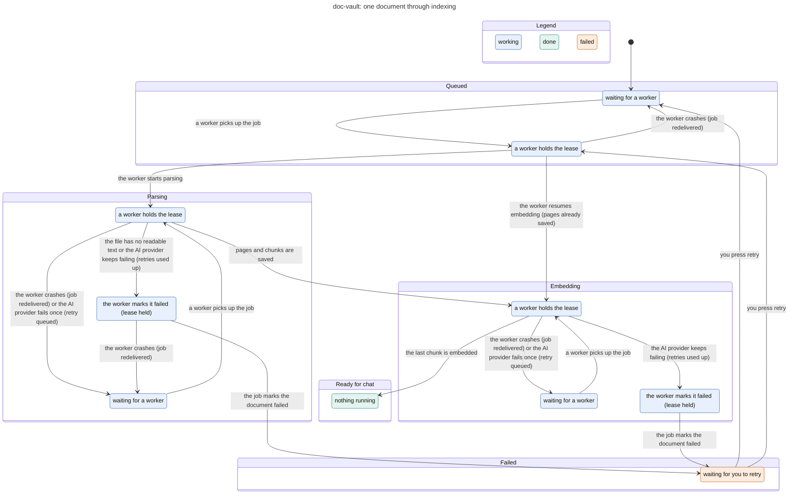

# Document lifecycle

This page shows how one uploaded document moves through indexing, from upload to "ready for chat". The chart covers what happens when a worker crashes, when the AI provider fails, when the same job arrives twice, and when you press retry. A model checker (TLC, on the TLA+ model in `formal/`) explored every order of those events within small bounds and checked the rules below. The chart is drawn from that model, not by hand.

The top-level states are the values of `status` in `GET /documents/{id}`. The inner states say whether a worker is working on the document at that moment.



## How to read it

- **Queued** means the upload is stored and a job is waiting in the Celery queue.
- **Parsing** ends in one database transaction that saves the pages, the chunks and the move to Embedding together. A crash before that commit leaves nothing behind, so the next attempt parses from scratch.
- **Embedding** commits after every batch of chunks. A crash keeps the batches already written, and the next attempt embeds only the chunks still missing.
- **Ready for chat** means every chunk has an embedding. Insights (summary, key facts) run separately, so a slow or failed summary never blocks chat. They are not in this chart.
- **Failed** stays failed until you call `POST /documents/{id}/retry`. A retry goes back to Queued. If the pages were already saved, the worker skips parsing and resumes embedding.
- "A worker holds the lease" means a worker holds the document's Postgres advisory lock (`db.pipeline_steps`). Postgres releases the lock when a worker dies. A duplicate job that cannot get the lock exits without doing anything.
- "The worker marks it failed (lease held)" is the failure path. `run_index` writes FAILED on its lease connection and only then releases the lease.
- "Waiting for a worker" is where a crashed or retried job sits until Celery redelivers it. It also covers a document that the minute check (`documents.reconcile`, every 60 seconds) re-queues after it has not moved for two minutes.
- A retry can land in the moment after FAILED is written and before the lease is released. That is the arrow from Failed to "Queued, a worker holds the lease". The retry's job finds the lease taken and exits, and the minute check picks the document up again within about three minutes.

## Rules the model checks

| Rule | In plain words | Status |
|---|---|---|
| `ReadyMeansSearchable` | A document shows Ready only when chat can search every one of its chunks. | Holds |
| `ParsedOnce` | Pages and chunks are written once. A rerun never parses again. | Holds |
| `OneWorkerAtATime` | Only one worker works on a document at a time, including while it records a failure. | Holds |
| `NotFailedWhileWorking` | A document never shows Failed while a worker is still processing it. | Holds since `3437628` (was finding F1) |
| `ReadyStaysReady` | A ready document never goes back to another status. | Holds |
| `FailedWaitsForYou` | A failed document changes only when you press retry. | Holds |
| `AlwaysSettles` | Every document in flight ends Ready or Failed, whatever crashes or duplicate jobs happen. | Holds |

Each rule was also shown to fail on a deliberately broken copy of the model that mirrors a real code bug (`python3 formal/check.py --mutants`). A check that has never failed proves nothing.

## Finding F1, found by the model and fixed

TLC found this before any test or live run did. Its shortest path:

1. A worker picks up the job, takes the lease and starts parsing.
2. The file has no readable text. The worker left the lease, then called `documents.fail()`.
3. In that gap the minute check had re-queued the document, and a second worker took the free lease and started parsing.
4. `fail()` was a compare-and-swap on `status` without the lease, so the document showed Failed while the second worker was still parsing.

The same race happened when the AI provider used up its retries, and on unexpected errors.

**The first fix idea was wrong, and the model said why.** That idea was to let `fail()` take the lease and skip when another worker holds it. TLC answered with a 31-step cycle that breaks `AlwaysSettles`. A file that can never be parsed loops forever, because every time one worker fails it, a re-queued worker has just taken the lease to try again.

**The fix** (`3437628`): `run_index` decides every terminal failure inside its own lease and writes FAILED before it releases the lease. The Celery task only retries. `tests/test_lifecycle_race.py` reproduces the race against real Postgres advisory locks for all three failure kinds. On the code before the fix it fails with `assert [True] == [False]`: the second worker got the lease. After the fix it passes.

## What the model leaves out

- Insights (`run_analyze`), document deletes, and re-embedding after an embedding-model change.
- Time. The two-minute stale threshold is modelled as "may happen at any moment", which can only add orders of events, never remove them.
- Size. The gate runs with 2 workers, 2 chunks, 1 crash, 2 provider faults, 1 Celery retry, 1 user retry and at most 2 queued jobs. The chart above uses 1 worker and 1 chunk, so it stays readable. A pass covers these bounds, not every possible run.
- A lost lease connection. If the worker cannot reach Postgres, it cannot write FAILED either. The document then waits for the minute check, by design, because a write without the lease would bring F1 back.

## Re-run it

```bash
python3 formal/check.py             # every rule, about 2 seconds
python3 formal/check.py --mutants   # prove each rule can fail, about 15 seconds
```

The checker needs Java 11 or later. It downloads the pinned `tla2tools.jar` (TLA+ 1.7.4) once and checks its SHA-256. To redraw the chart, run the `/statechart` skill on `formal/DocLifecycle.tla` with `formal/DocLifecycle-doc.cfg` and the view in `formal/view.ts`.
